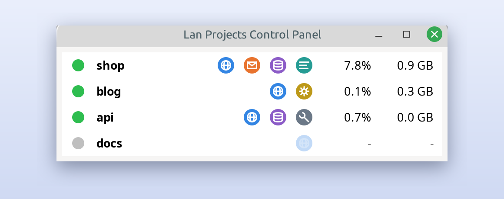

<p align="center">
  
</p>

<h1 align="center">LanProjectsControlPanel</h1>

<p align="center">
  <b>Run every docker project on your machine at once.<br>Each one on its own port 80.</b>
</p>

<p align="center">
  
  
  
  
</p>

<p align="center">
  
</p>

---

## Port 80 is taken. Again.

You have a shop, a blog and an API. They all want port 80, 443 and 5432. So you edit compose files, invent
`8081`, `8082` and `5433`, forget which is which, and stop one project to start another.

**Stop doing that.** Give every project its own address instead, and let every one of them keep its usual ports.

## The trick

A port belongs to an *address*, not to the whole machine. Linux hands you 16 million loopback addresses
(`127.0.0.1` to `127.255.255.254`), so each project gets one of its own and starts there:

```
https://shop.localhost  ─┐                          ┌─►  127.0.0.2   shop   :80  :5432
https://blog.localhost  ─┼─►  proxy 127.0.0.1:443  ─┼─►  127.0.0.3   blog   :80  :5432
https://api.localhost   ─┘                          └─►  127.0.0.4   api    :80  :5432

https://dev.example.com  ─────────────────────────────►  192.168.1.20  a project with its own domain,
                                                                       its own TLS, on your LAN
```

Everything that matters stays the way it was: three web servers on port 80, three Postgres databases on 5432.
They can't collide, because they were never in the same place.

## Why you'll like it

| | |
|---|---|
| **No port juggling** | Every project keeps its real ports, databases included. Nothing to remember. |
| **Names, not numbers** | `https://shop.localhost`. No DNS, no hosts file, no `sudo`: browsers always send `*.localhost` to 127.0.0.1. |
| **Your projects stay standalone** | A project learns one flag, `--bind=IP`, and ignores it unless it's given. Anyone who clones it without this tool runs it exactly as before. |
| **A control panel you'll keep open** | Start and stop projects with a click, jump into their sites, and watch what each one costs in CPU and RAM. |
| **A panic button** | The machine suddenly crawling? <kbd>Ctrl</kbd>+<kbd>Alt</kbd>+click the tray icon and the busiest project is killed in about two seconds. |
| **Test on your phone** | Bind a project to your LAN address with its real hostnames and certificates, and open it from a tablet. |
| **Agent-ready** | Ships a skill that teaches a coding agent how to make any project compatible, and how to check it didn't break. |

## Meet the control panel

`./dev ui` opens it. One row per project:

- **A status dot you can click.** Green means it's up and answering, red means the last start failed, grey
  means stopped. Click to start or stop it. The dot pulses while it works.
- **Round launcher icons that tell you what they open** before you read a tooltip. A project lists its own, each
  with a class:

  | | class | opens |
  |---|---|---|
  | 🔵 | `web` | the site itself |
  | 🟠 | `mail` | a mail catcher or webmail |
  | 🟣 | `db` | a database or data browser |
  | 🟢 | `logs` | logs, docs, anything you read |
  | 🟡 | `config` | settings or an admin area |
  | ⚪ | `tool` | a shell or any other dev tool |

- **Live CPU and memory** for each project, summed over all of its containers.
- **A tray icon** (Linux Mint, via XApp): the window drops from the icon like a menu and hides again on the
  next click. While it's hidden it makes no docker calls at all.
- **Failures come to you** as desktop notifications, and nothing sits permanently at the bottom of the window.

It's a small GTK window, 450 px wide, and it only needs Python's GTK bindings, which most Linux desktops already
have.

## Up and running in a minute

```bash
git clone https://github.com/AntzCode/LanProjectsControlPanel.git
cd LanProjectsControlPanel

./dev add shop ~/Projects/shop       # register your projects
./dev add blog ~/Projects/blog

./dev up                             # start them all, each on its own address
./dev ls                             # addresses, URLs and what's running
./dev ui --tray                      # optional: the control panel, in your tray
```

Then open `https://shop.localhost`. Add `--install` to `./dev ui --tray` once and the tray icon starts at login.
(HTTPS uses Caddy's own local CA. `./dev trust` exports the certificate,
or set `https = false` for plain `http://`.)

## Making a project play along

The whole contract fits in four lines:

| Run | The project listens on |
|---|---|
| `./dev up` | `127.0.0.1`: this machine only, always the default |
| `./dev up --bind=127.0.0.3` | that address instead, with the same ports. This is what the panel calls |
| `./dev up --lan` | every address, for phones and tablets |
| `./dev up --host shop.loc` | answers to that name, at `http://shop.loc` once your hosts file points there |

In compose it's one change per published port: `"${BIND:-127.0.0.1}:80:80"`. A runnable reference is in
[`examples/`](examples).

**Or let your coding agent do it.** Install the skill once, then ask for it:

```bash
ln -s "$PWD/skills/lpcp-docker-projects" ~/.claude/skills/lpcp-docker-projects
```

> *"Make this project work with LanProjectsControlPanel."*

The skill walks the agent through the compose change, the `./dev` flags, the launchers and the checks that prove
the project still runs on its own.

## How it compares

| | Port numbers per project | Label proxies (Traefik, caddy-docker-proxy) | Local DNS (dnsmasq) | **LanProjectsControlPanel** |
|---|:---:|:---:|:---:|:---:|
| Every project keeps its real ports | no | web only | no | **yes** |
| Databases and other non-HTTP ports | juggle them | limited | no help | **yes** |
| Compose files stay untouched for anyone else | no | no (labels, shared network) | yes | **yes** |
| No `sudo`, DNS or hosts file | yes | yes | no | **yes** |
| Names instead of port numbers | no | yes | yes | **yes** |
| A window to start, stop and watch projects | no | no | no | **yes** |

## Good to know

- **Linux first.** macOS only has `127.0.0.1` unless an admin adds loopback aliases.
- **`*.localhost` only works on the machine you're on.** For other devices, bind the project to the LAN address
  and give it real hostnames.
- **Anything listening on `0.0.0.0` blocks everyone.** `./dev up` names it and refuses to start into a
  conflict, and `./dev doctor` finds it for you.
- **No packages to install.** The tool is the Python standard library. Caddy runs as a container. Needs Docker
  with Compose, Python 3.11+ and `ss`.

## Read more

- **[The manual](docs/manual.md):** every command, the registry file, the tray icon and panic mode in detail,
  HTTPS, limits, and how it was tested.
- **[The agent skill](skills/lpcp-docker-projects/SKILL.md):** the full contract, step by step.
- **[`examples/`](examples):** a complete project that follows the contract.

## License

Copyright (C) 2026 AntzCode. Licensed under the [GNU Affero General Public License v3.0](LICENSE)
(`AGPL-3.0-only`).
